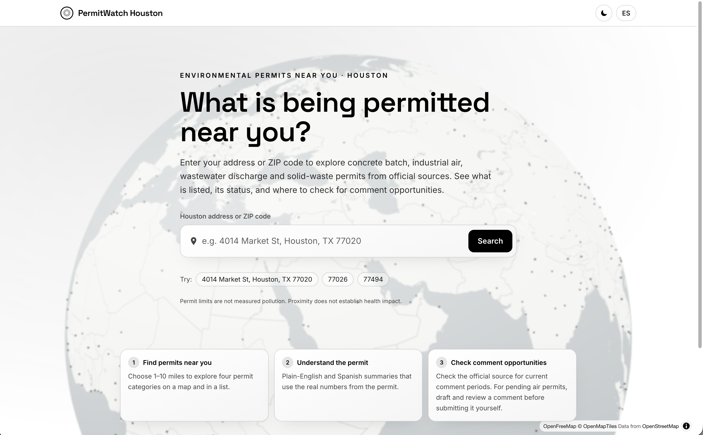

# **PermitWatch Houston**

> **Understand the permits in your neighborhood.**

Enter a Houston address or ZIP code, then choose a search distance from 1–10 miles (default 3). The slider updates one map boundary, permit markers, results, and listed capacity together; links and page refresh preserve the selected distance. PermitWatch explores four environmental permit categories from TCEQ and EPA: concrete batch plants, industrial air, wastewater discharge and solid waste. Category/status filters, category counts and labeled marker symbols keep the map understandable. The current source-scoped snapshot contains 807 real permits; coverage is not exhaustive. Deadlines and comment opportunities are shown only when supported by the official record.

Summaries and editable comment drafts are built directly from the dataset fields and your selected concerns. No AI provider or API key is required. Always verify the current comment window with the official source.

Built for **CodeRED Orion (University of Houston) hackathon**.

> Includes permit search, maps, details, official links, data-only summaries, and editable draft templates.

---

# **Product Demo**


[DEMO LINK](https://permitwatch-houston.onrender.com/)

PermitWatch lets users search a Houston address or ZIP code and immediately explore environmental permits around that location.

### **1. Search a location**

Enter an address or ZIP code in the Houston area.

The map centers on the selected location and marks it with a circular location marker.

### **2. Choose a search radius**

Select a radius from **1–10 miles**, with **3 miles** as the default.

Changing the distance updates the:

- Map boundary
- Permit markers
- Results
- Category counts
- Listed capacity

The selected distance is preserved when refreshing or sharing the page.

### **3. Explore nearby permits**

PermitWatch displays four environmental permit categories:

- Concrete batch plants
- Industrial air permits
- Wastewater discharge permits
- Solid waste permits

Category and permit-status filters can be used to narrow the results.

Permits at identical coordinates are shown with separate selectable icons; screen offsets do not change source coordinates or distances.

### **4. View permit details**

Selecting a permit provides the available source information, official links and permit details.

Missing information is clearly displayed as:

> **Not listed in source – check official record**

Comment deadlines and public-comment opportunities are only shown when supported by the official record.

All records also offer an editable draft. Pending applications use the existing comment flow, while unknown or historical authorizations use concerns or information-request wording and the official TCEQ complaint link.

### **Demo Location**

Try:

**5303 S Lake Houston Pkwy, Houston, TX 77049**

Default radius: **3 miles**

This location returns **18 permits across all four categories** in the current snapshot.

See [multi-category verification](docs/multi-permit-verification.md) for coverage, tests and remaining limitations.

---

# **Tutorial**

## **Quick start**

Requires Node.js 22.12 or newer.

```bash
npm install
cp .env.example .env
npm run import -- data/validated-permits.json # real validated TCEQ/EPA permit records
npm run dev                                   # API on :8787, web app on :5173
```

### **Refreshing and importing the real dataset**

The original broad dataset remains in `data/sites.json`. Deployments use the accepted records in `data/validated-permits.json`; exclusions and missing-field coverage are recorded in `data/permit-validation.json`.

See [the data workflow](data/README.md) for refresh and validation commands.

### **Importing a dataset**

```bash
npm run import -- path/to/permits.csv
npm run import -- path/to/permits.json --remove-samples
```

`.csv` and `.json` files are supported. Bad rows are rejected and logged rather than crashing the import.

Using `--remove-samples` also deletes the SAMPLE rows.

Imports never call an AI service. Rows with missing coordinates are geocoded when possible; unresolved locations are rejected with an import issue and excluded from maps/counts.

Every row is validated with Zod. Invalid required fields reject the row. Invalid optional fields are cleared and shown as:

> **Not listed in source – check official record**

All issues are printed and stored in `import_issues`.

## **Scripts**

| Script | What it does |
| --- | --- |
| `npm run check` | Typecheck + lint + unit tests |
| `npm run test:e2e` | Playwright end-to-end tests against the production frontend and local API |
| `npm run test:stress` | Progressive local API load test; run after building |
| `npm run scan:secrets` | Scans source, ignored environment files, and generated output for credentials |
| `npm run build` / `npm start` | Production build / start |

Install Chromium once with:

```bash
npx playwright install chromium
```

Browser tests use a temporary in-memory database, offline address fixtures, and a local map style; they exercise the real map canvas and markers without external service availability affecting the results.

The load test uses the located records in the real dataset and calls only local endpoints.

## **Production**

`render.yaml` builds the client and server, imports the real dataset, and starts one service for the frontend and API.

Configure `DATABASE_PATH` and `ALLOWED_ORIGINS` as shown in `.env.example`; the Render service URL is automatically allowed.

Locally, run:

```bash
npm run build
npm run import:prod -- data/validated-permits.json
npm start
```

## **Data rules**

- Every number shown comes from the permit dataset or a cited API. Missing fields read **"Not listed in source – check official record"**.
- Comment deadlines are shown only when they appear in the data. Nothing is computed.
- Permits show maximum allowed activity, not measured pollution. The app makes no health claims.
- `data/sample-permits.json` is **SAMPLE DATA**: fictional companies, flagged with a "Sample data" badge in the UI.

The header appearance switch uses orange accents on black in dark mode and a white/black palette in light mode. It starts from your device appearance, then remembers your selection locally. The map style and distance wall follow the selected mode.

### **Multi-category API**

The existing search route accepts a supported optional category and/or permit status, alongside a location and radius:

```http
GET /api/search?q=Houston&lat=29.81068&lng=-95.21326&radius=3&category=wastewater_permit&status=effective
```

`GET /api/permits/:id` returns source provenance and nullable details.

Category values:

- `concrete_batch_plant`
- `air_permit`
- `wastewater_permit`
- `solid_waste_permit`

Status values:

- `pending`
- `effective`
- `issued`
- `administratively_continued`
- `expired`
- `unknown`

Unsupported or repeated values return `400`.

Filters apply consistently to results, category counts and the nearest matching outside record.